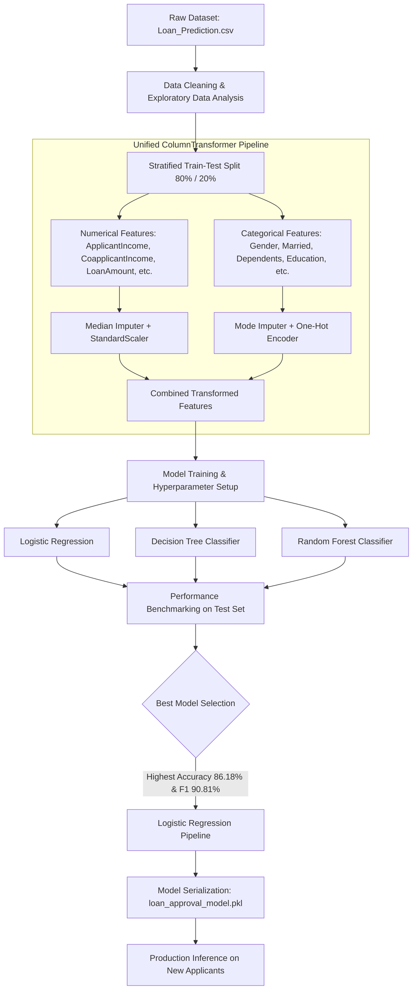

# 🏦 Loan Approval Prediction Using Machine Learning

[](https://www.python.org/)
[](https://scikit-learn.org/)
[](https://pandas.pydata.org/)
[](https://numpy.org/)
[](https://jupyter.org/)
[](https://youtu.be/pO-6Qt0HnP4)
[](LICENSE)

An end-to-end Machine Learning classification project designed to automate and streamline the loan eligibility assessment process. By analyzing applicant socioeconomic and credit history data, the system predicts whether a loan application is likely to be **Approved (Y)** or **Rejected (N)** with high precision and recall.

---

## 📺 Project Demo Video

Watch a complete walkthrough of the project, including dataset exploration, preprocessing pipeline implementation, multi-model evaluation, and live inference:

<div align="center">
  <a href="https://youtu.be/pO-6Qt0HnP4" target="_blank">
    
  </a>
  <p>
    ▶️ <strong><a href="https://youtu.be/pO-6Qt0HnP4" target="_blank">Click here to watch the full project demonstration on YouTube</a></strong>
  </p>
</div>

---

## 📌 Table of Contents

- [Project Overview](#-project-overview)
- [Key Objectives](#-key-objectives)
- [Project Architecture & Workflow](#-project-architecture--workflow)
- [Dataset & Feature Dictionary](#-dataset--feature-dictionary)
- [Data Preprocessing & Pipeline](#-data-preprocessing--pipeline)
- [Model Evaluation & Comparison](#-model-evaluation--comparison)
- [Model Deployment & Inference](#-model-deployment--inference)
- [Project Structure](#-project-structure)
- [Getting Started & Installation](#-getting-started--installation)
- [Technologies Used](#-technologies-used)
- [Disclaimer](#-disclaimer)
- [Author](#-author)

---

## 📖 Project Overview

In the banking and financial sector, assessing loan risk is critical. Manual underwriting of loan applications is often time-consuming, prone to subjective bias, and cost-intensive. 

This project addresses these challenges by developing a robust predictive Machine Learning system that:
- Evaluates key applicant attributes such as credit history, income, loan amount, education, and property area.
- Implements an end-to-end scikit-learn preprocessing and modeling pipeline to prevent data leakage.
- Benchmarks multiple classification algorithms (Logistic Regression, Decision Trees, Random Forest).
- Serializes the best-performing model (`loan_approval_model.pkl`) for rapid deployment and automated inference on unseen applicant data.

---

## 🎯 Key Objectives

1. **Exploratory Data Analysis (EDA):** Understand feature distributions, demographic patterns, and correlations with loan approval status.
2. **Robust Data Preprocessing:** Implement automated numerical scaling and median imputation, alongside categorical mode imputation and one-hot encoding.
3. **Leak-Free Pipeline Architecture:** Encapsulate transformers and estimators within unified Scikit-Learn `Pipeline` and `ColumnTransformer` objects.
4. **Model Benchmarking:** Train and evaluate multiple classifiers on stratified test splits using Accuracy, Precision, Recall, and F1-score.
5. **Model Export & Live Demonstration:** Save the top-performing pipeline with `joblib` and demonstrate real-time predictions.

---

## 🏗️ Project Architecture & Workflow



---

## 📊 Dataset & Feature Dictionary

The model is trained on [`Loan_Prediction.csv`](file:///c:/Users/avant/synent-task8-loanprediction-avanthiga/Loan_Prediction.csv) containing 614 applicant records with 12 input features and 1 target variable.

| Feature Name | Type | Description | Values / Examples |
| :--- | :---: | :--- | :--- |
| `Loan_ID` | String | Unique applicant identification key | `LP001002`, `LP001003` *(Dropped during training)* |
| `Gender` | Categorical | Applicant's gender | `Male`, `Female` |
| `Married` | Categorical | Marital status | `Yes`, `No` |
| `Dependents` | Categorical | Number of family dependents | `0`, `1`, `2`, `3+` |
| `Education` | Categorical | Applicant education level | `Graduate`, `Not Graduate` |
| `Self_Employed` | Categorical | Employment nature | `Yes`, `No` |
| `ApplicantIncome` | Numeric | Monthly income of the primary applicant | e.g. `5849`, `4583` |
| `CoapplicantIncome` | Numeric | Monthly income of the co-applicant | e.g. `0`, `1508` |
| `LoanAmount` | Numeric | Requested loan amount (in thousands) | e.g. `128`, `66` |
| `Loan_Amount_Term` | Numeric | Duration of the loan (in months) | e.g. `360`, `180` |
| `Credit_History` | Numeric / Binary | Credit history meets guidelines | `1.0` (Good), `0.0` (Poor) |
| `Property_Area` | Categorical | Location of the property | `Urban`, `Semiurban`, `Rural` |
| **`Loan_Status`** | **Categorical (Target)** | **Loan approval decision** | **`Y` (Approved), `N` (Rejected)** |

---

## ⚙️ Data Preprocessing & Pipeline

To ensure model reproducibility and eliminate data leakage, all transformations are encapsulated into a Scikit-Learn `ColumnTransformer`:

- **Numerical Features** (`ApplicantIncome`, `CoapplicantIncome`, `LoanAmount`, `Loan_Amount_Term`, `Credit_History`):
  - Missing values imputed using **Median** strategy (`SimpleImputer(strategy='median')`).
  - Feature normalization and standardization via **StandardScaler** (`StandardScaler()`).
- **Categorical Features** (`Gender`, `Married`, `Dependents`, `Education`, `Self_Employed`, `Property_Area`):
  - Missing values imputed using **Most Frequent (Mode)** strategy (`SimpleImputer(strategy='most_frequent')`).
  - Categorical variables converted into binary vectors using **One-Hot Encoding** (`OneHotEncoder(handle_unknown='ignore')`).
- **Data Splitting**:
  - 80% Training (491 records) and 20% Testing (123 records).
  - Target-stratified split (`stratify=y`, `random_state=42`) to maintain class balance across both subsets.

---

## 🤖 Model Evaluation & Comparison

Three classification algorithms were trained and evaluated on unseen test data. The evaluation metrics focused on **Accuracy**, **Precision**, **Recall**, and **F1-Score** for the positive class (`Y` - Loan Approved):

| Model | Accuracy (%) | Precision (%) | Recall (%) | F1-Score (%) |
| :--- | :---: | :---: | :---: | :---: |
| 🥇 **Logistic Regression** | **86.18%** | **84.00%** | **98.82%** | **90.81%** |
| 🥈 **Random Forest Classifier** | **85.37%** | **83.17%** | **98.82%** | **90.32%** |
| 🥉 **Decision Tree Classifier** | **82.11%** | **82.47%** | **94.12%** | **87.91%** |

### 🔍 Key Insights:
- **Best Overall Model:** **Logistic Regression** achieved the highest test accuracy (**86.18%**) and best F1-Score (**90.81%**).
- **Exceptional Recall:** Both Logistic Regression and Random Forest demonstrated a **98.82% recall** on approved loans, minimizing false rejections of eligible borrowers.
- **Credit History Impact:** Exploratory feature analysis verified that applicant credit history (`Credit_History = 1.0`) is the single strongest indicator of loan approval status.

---

## 🚀 Model Deployment & Inference

The final selected model is serialized as [`loan_approval_model.pkl`](file:///c:/Users/avant/synent-task8-loanprediction-avanthiga/loan_approval_model.pkl). Because the model is saved with the complete Scikit-Learn pipeline, **raw input data can be passed directly** without manual preprocessing or one-hot encoding.

### Sample Prediction Code:

```python
import joblib
import pandas as pd

# 1. Load the trained end-to-end pipeline
model = joblib.load("loan_approval_model.pkl")

# 2. Define a new applicant's profile (raw input features)
applicant = pd.DataFrame([{
    "Gender": "Male",
    "Married": "Yes",
    "Dependents": "0",
    "Education": "Graduate",
    "Self_Employed": "No",
    "ApplicantIncome": 5000,
    "CoapplicantIncome": 1500,
    "LoanAmount": 120,
    "Loan_Amount_Term": 360,
    "Credit_History": 1.0,
    "Property_Area": "Urban"
}])

# 3. Predict approval status
prediction = model.predict(applicant)[0]

if prediction == "Y":
    print("✅ Prediction: Loan Approved")
else:
    print("❌ Prediction: Loan Rejected")
```

---

## 📁 Project Structure

```text
synent-task8-loanprediction-avanthiga/
│
├── Loan_Approval_Prediction.ipynb  # Complete interactive Jupyter/Colab notebook
├── Loan_Prediction.csv             # Loan applicant dataset (614 records)
├── loan_approval_model.pkl         # Serialized Scikit-Learn pipeline (Best Model)
├── requirements.txt                # Required Python libraries and dependencies
└── README.md                       # Comprehensive project documentation
```

---

## 💻 Getting Started & Installation

### Option 1: Run Locally

1. **Clone the Repository:**
   ```bash
   git clone https://github.com/avanthiga0630/synent-task8-loanprediction-avanthiga.git
   cd synent-task8-loanprediction-avanthiga
   ```

2. **Create and Activate a Virtual Environment (Optional but Recommended):**
   ```bash
   # Windows
   python -m venv venv
   .\venv\Scripts\activate

   # Linux / macOS
   python3 -m venv venv
   source venv/bin/activate
   ```

3. **Install Dependencies:**
   ```bash
   pip install -r requirements.txt
   ```

4. **Launch the Jupyter Notebook:**
   ```bash
   jupyter notebook Loan_Approval_Prediction.ipynb
   ```

### Option 2: Run in Google Colab

1. Open [Google Colab](https://colab.research.google.com/).
2. Select **File > Open notebook** and upload [`Loan_Approval_Prediction.ipynb`](file:///c:/Users/avant/synent-task8-loanprediction-avanthiga/Loan_Approval_Prediction.ipynb) (or import directly from GitHub).
3. Ensure [`Loan_Prediction.csv`](file:///c:/Users/avant/synent-task8-loanprediction-avanthiga/Loan_Prediction.csv) is uploaded to the Colab environment runtime.
4. Run all cells sequentially (**Runtime > Run all**).

---

## 🛠️ Technologies Used

| Technology / Library | Purpose |
| :--- | :--- |
| **Python** | Core programming language |
| **Pandas** | Data wrangling, exploration, and structured analysis |
| **NumPy** | Vectorized array operations and numerical computations |
| **Scikit-Learn** | ML algorithms, preprocessing pipelines, model evaluation |
| **Matplotlib & Seaborn** | Exploratory data visualization and performance plots |
| **Joblib** | Model serialization and persistence (`.pkl`) |
| **Jupyter Notebook / Google Colab** | Interactive model development and experimental workflow |

---

## ⚠️ Disclaimer

This project is developed for educational and portfolio demonstration purposes. Machine Learning predictions in financial domains should be supplemented with regulatory compliance checks and human underwriting review before making real-world lending decisions.

---

## 👤 Author

**Avanthiga**  
- **GitHub:** [@avanthiga0630](https://github.com/avanthiga0630)  
- **Repository:** [synent-task8-loanprediction-avanthiga](https://github.com/avanthiga0630/synent-task8-loanprediction-avanthiga)  
- **Demo Video:** [YouTube Walkthrough](https://youtu.be/pO-6Qt0HnP4)
